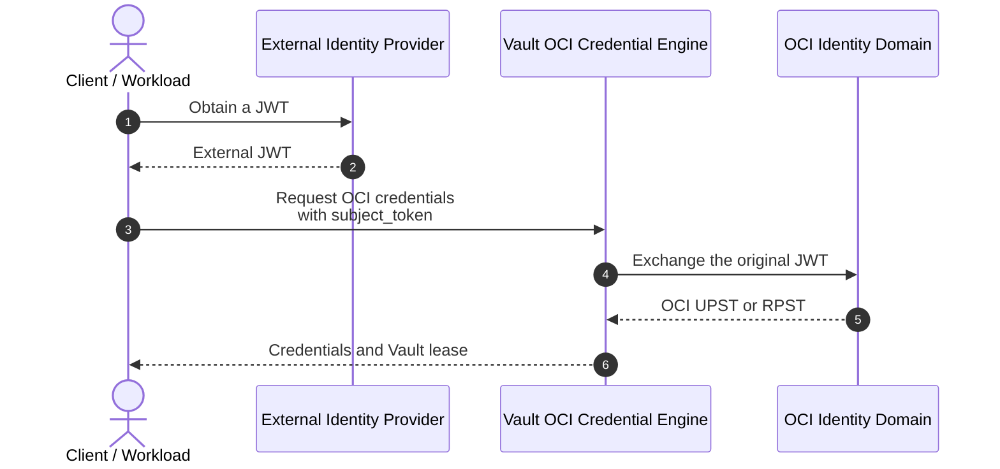
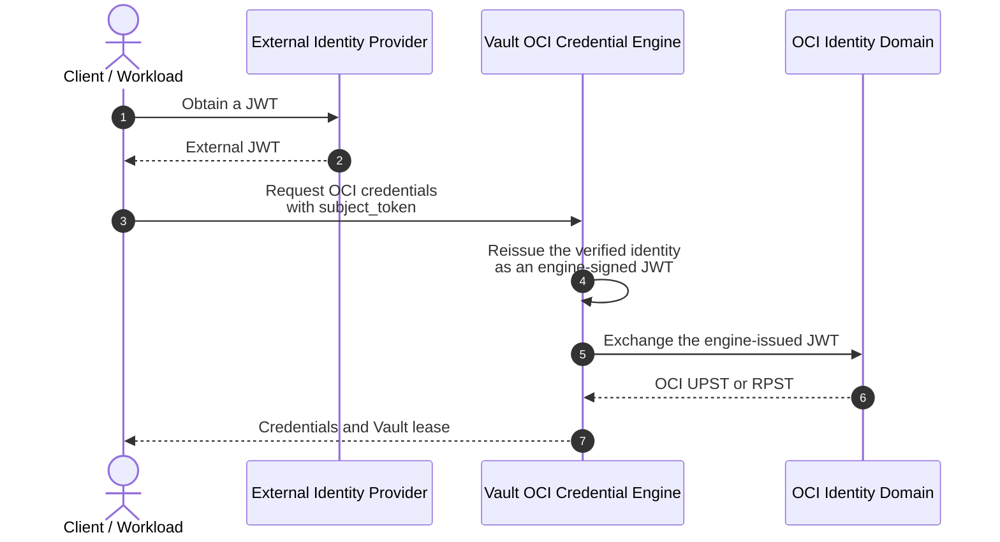
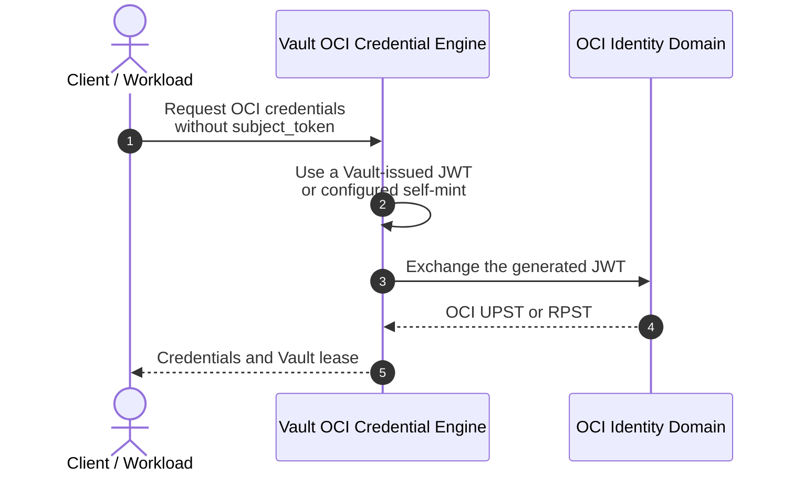
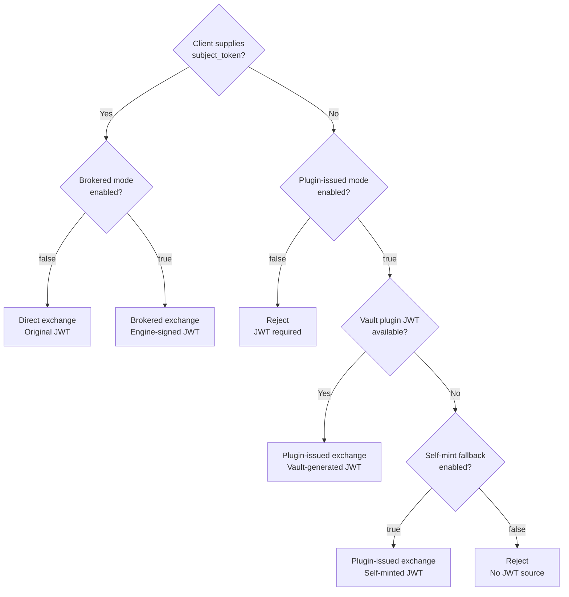
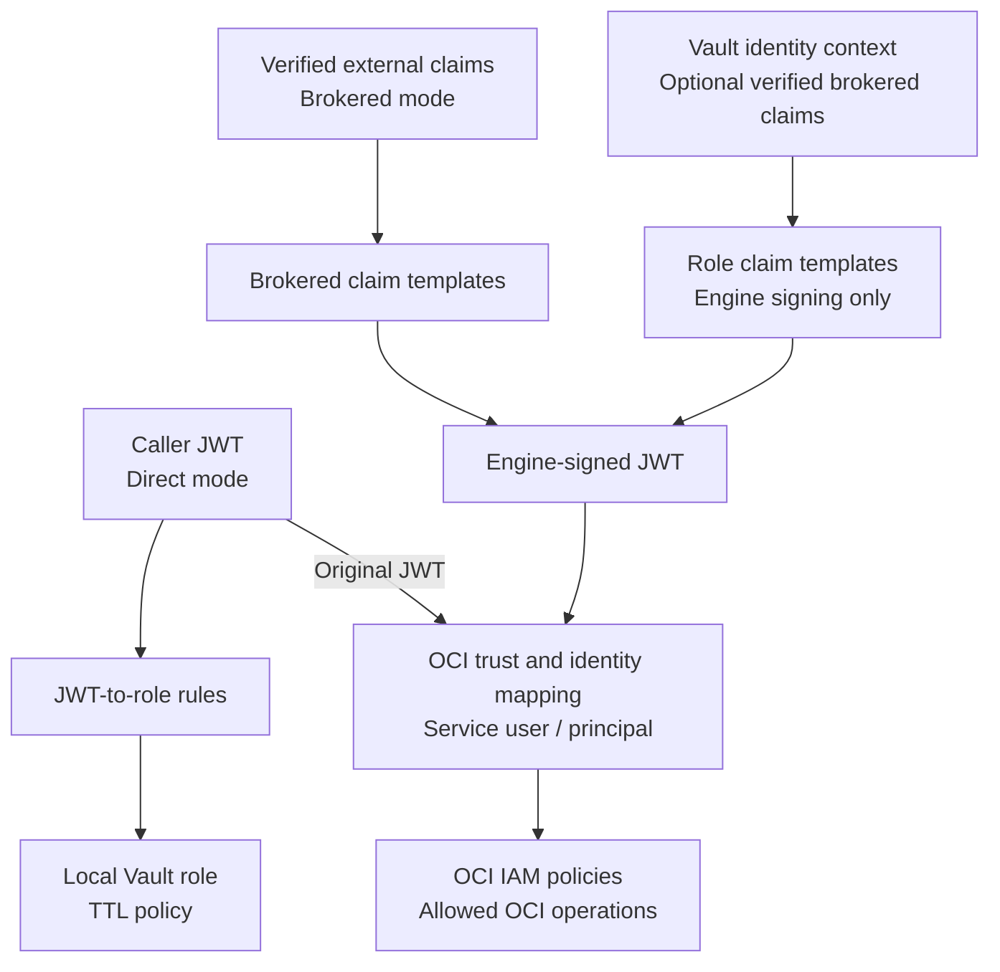

# HashiCorp Vault OCI Secrets Engine

A HashiCorp Vault secrets engine that exchanges JWTs for temporary Oracle Cloud Infrastructure (OCI) credentials. Clients can supply an external JWT or ask the engine to obtain a subject token using Vault.

## Overview

Use this engine to obtain OCI User Principal Session Tokens (UPST) or Resource Principal Session Tokens (RPST) without storing long-lived OCI API keys in Vault. Vault controls who can request credentials; OCI trust and IAM policies determine the resulting OCI identity and permissions.

| I want to… | Start here |
|---|---|
| Understand what a client sends and receives | [Exchange modes](#exchange-modes-client-view) |
| Choose the mode and understand flag interactions | [Mode selection](#how-configuration-selects-the-mode) |
| Select a Vault role or shape OCI-facing identity claims | [Mapping features](#mapping-features) |
| Install and configure a mount | [Installation](#installation) and [Configuration](#configuration) |
| Send requests or integrate an OCI client | [Usage](#usage) and the [API reference](docs/usage.md#api-reference) |
| Set access boundaries or plan an upgrade | [Security](#security) and [upgrade guidance](docs/configuration.md#removed-role-filter-fields-and-upgrade-cleanup) |

### Exchange Modes (Client View)

These sequences show what a client supplies and receives. The client has already authenticated to Vault, and an operator has configured the engine and OCI trust. The engine's configuration determines the exchange mode.

| Mode | Client supplies | Subject token sent to OCI |
|---|---|---|
| Direct exchange | External JWT as `subject_token` | The original external JWT |
| Brokered exchange | External JWT as `subject_token` | A new engine-signed JWT |
| Plugin-issued exchange | No `subject_token` | A Vault-issued or self-minted JWT |

All three modes return OCI credentials and Vault lease metadata. Choose UPST or RPST with `requested_token_type`; RPST also requires `res_type`. If the client omits `public_key`, the response includes an engine-generated exchange private key. If the client supplies its public key, it keeps the corresponding private key.

#### 1) Direct Exchange: Client Supplies the JWT



The engine passes the original JWT to OCI, which validates it before issuing credentials. Use `oci/exchange` or `oci/exchange/<role>` as configured by the operator. With JWT-to-role mapping, use the bare `oci/exchange` path; the engine selects a role while passing the original JWT to OCI.

#### 2) Brokered Exchange: Engine Reissues the Identity



The client supplies an external JWT just as in direct mode. With brokered mode configured, the engine verifies that token and issues a new JWT containing the configured identity claims. OCI trusts the engine's issuer for this exchange.

#### 3) Plugin-Issued Exchange: Client Omits the JWT



The client requests credentials without obtaining an external JWT. Plugin-issued mode must be enabled. The engine prefers Vault identity-token generation where available and can fall back to explicitly configured self-minting. If neither token source is available, the exchange fails.

See [Usage](#usage) for request examples and response details, and [Configuration](#configuration) for operator settings. The [diagram index](docs/sequence-diagrams/README.md) links to these client views and the separate detailed maintainer diagrams.

## How Configuration Selects the Mode

A mount can support more than one mode. The presence of `subject_token` in each request determines which settings apply. The following decision tree assumes valid configuration, an authorized request, and a nonempty JWT when one is supplied. The table below identifies the configuration flags for each choice.



| Desired behavior | Configuration | Mapping and trust |
|---|---|---|
| Pass the caller JWT through to OCI | `brokered_subject_token_enabled=false` | Optional `subject_token_role_mappings` selects a local role; OCI trusts the original issuer |
| Verify and reissue the caller JWT | `brokered_subject_token_enabled=true`, incoming JWT trust, and `subject_token_self_mint_issuer` | Optional brokered claim mappings and explicit-role templates; OCI trusts the engine issuer |
| Accept requests without a caller JWT | `enable_plugin_issued_subject_token=true` | Vault-generated plugin token first; OCI trusts that token's issuer and claims |
| Allow self-mint when Vault cannot issue a token | Also set `subject_token_self_mint_enabled=true` and configure the signing issuer | Vault identity claims and optional explicit-role templates; OCI trusts the engine issuer |

`brokered_subject_token_enabled` applies only when a JWT is supplied. `enable_plugin_issued_subject_token` applies only when it is omitted. If both are enabled, the same mount can serve brokered and plugin-issued requests. A failed brokered verification does not fall back to direct exchange.

Self-mint is a fallback for omitted-token requests; enabling it does not override a successful Vault-generated token. Brokered reissue uses the shared signing settings independently of the self-mint fallback flag. See the [signing and JWKS configuration](docs/configuration.md#self-mint-jwks-publication-workflow) for setup.

The implementation defaults are **brokered off**, **plugin-issued on**, and **self-mint off**. The [base configuration below](#configuration) explicitly turns plugin-issued mode off until it is needed. `requested_token_type` selects UPST or RPST in any mode; it does not select the exchange mode.

## Mapping Features

There are three engine mapping features, followed by a separate OCI-side identity mapping. Choose the feature according to what you want to change:

| Goal | Setting and location | Input → result | Applies to |
|---|---|---|---|
| Select local lease and RPST TTL policy | `subject_token_role_mappings` on `oci/config` | Decoded JWT claim → existing Vault role | Direct caller-token exchange only |
| Normalize external identity claims | `brokered_subject_token_claim_mappings` on `oci/config` | Verified `claims.*` → added claims in a new JWT | Brokered exchange only |
| Add workload-specific identity claims | `self_mint_custom_claims` on `oci/role/<name>` | `vault.*`, literals, and optionally `brokered.claims.*` → added claims in a new JWT | Explicit role with self-mint fallback or brokered reissue |
| Choose the OCI principal and permissions | OCI Identity Domain trust/mapping and OCI IAM policies | JWT issuer, audience, and claims → OCI identity and allowed operations | Every mode; configured outside this engine |



The diagram shows the configurable mappings. Engine-signed JWTs also contain standard JWT claims and available Vault identity claims automatically. Direct mode sends the original JWT to OCI unchanged; selecting a local Vault role does not select an OCI service user or grant OCI permissions.

### 1. Map JWT Claims to a Vault Role

Use this when clients supply JWTs and an operator wants their claims to select the local role. For an already configured direct-mode mount, this rule selects `developer` when the JWT's top-level `team` claim equals `engineering`:

```bash
vault write oci/config \
    subject_token_role_mappings='[
      {"claim":"team","op":"eq","value":"engineering","role":"developer"}
    ]'
```

Create the role first and call bare `oci/exchange`. Rules run in order and the first match wins; no match rejects the request. With mappings configured, direct-mode requests to `oci/exchange/<role>` are rejected. `eq`, `co`, and `sw` mean equals, substring contains, and starts with; they work on a string or individual elements of a string array.

This is delegated role selection: the engine reads decoded claims, and OCI must authenticate the unchanged JWT. The rules do not provide local JWT verification. [Full role-mapping recipe](docs/usage.md#caller-supplied-subject-token-flow-jwt-claim-to-vault-role-mapping).

### 2. Map External Claims into a Brokered JWT

Use this to normalize external identity claims into the format expected by OCI. With brokered mode and incoming trust configured, this mapping copies a verified subject and builds a principal string:

```bash
vault write oci/config \
    brokered_subject_token_claim_mappings='{
      "external_sub":"{{ claims.sub }}",
      "principal":"svc/{{ claims.org }}/{{ claims.app }}"
    }'
```

For incoming `sub=user-123`, `org=acme`, and `app=billing`, the new JWT adds `external_sub=user-123` and `principal=svc/acme/billing`. The engine signs the new token; the incoming JWT is not sent to OCI. These mappings do not choose a Vault role. Direct-mode role mappings are ignored in brokered mode; use an explicit role path if local role policy is needed. [Full brokered recipe](docs/usage.md#brokered-caller-supplied-subject-token-flow-template-based-claim-mapping).

### 3. Add Claims from Vault Identity Context

Use this when OCI needs stable Vault identity attributes or an operator-defined workload label. This role adds an entity reference and joins the caller's Vault groups:

```bash
vault write oci/role/developer \
    default_ttl=1800 \
    max_ttl=3600 \
    self_mint_custom_claims='{
      "entity_ref":"entity/{{ vault.entity.id }}",
      "group_list":"{{ join(vault.groups, \",\") }}"
    }'
```

Call `oci/exchange/<role>`. The templates apply when the engine signs a JWT, including brokered reissue. In brokered mode, role templates can additionally use verified external values through `brokered.claims.*`. They do not alter direct pass-through JWTs or Vault-generated plugin identity tokens.

Brokered and role claim templates are additive: they cannot replace standard JWT claims, `vault_*` claims, or another assembled claim. Missing template values and claim collisions reject the exchange. The role name is not automatically copied into a JWT. Operator-configured literal claims must be protected by role-path ACLs and OCI trust rules. [Template recipes and inputs](docs/usage.md#role-scoped-custom-claims-for-self-mint).

Linked alias data requires explicit `subject_token_identity_alias_mount_accessor` configuration. It describes an identity linked to the Vault entity and does not attest how the current Vault token logged in. [Alias selection and trust boundary](docs/usage.md#explicit-linked-alias-selection).

### Terminology

| Term | Meaning |
|---|---|
| Subject token | JWT presented to OCI for exchange: the original caller token, a Vault-generated plugin token, or an engine-signed token |
| Vault role | Local policy and optional claim templates stored at `oci/role/<name>` |
| OCI principal | Identity selected by OCI trust and mapping rules; its IAM policies control OCI access |
| UPST / RPST | OCI User Principal Session Token / Resource Principal Session Token; RPST requests also require `res_type` |

## Prerequisites

- Go 1.26.11 or later to build the plugin; use a supported, patched Go release.
- Vault with external secrets-engine plugin support. Validate version/edition compatibility; no tested compatibility matrix is published. Vault-generated plugin identity tokens depend on Vault version/edition; configured self-mint is the fallback when unavailable.
- An OCI Identity Domain and confidential application configured for token exchange, with trust in the issuer used by your selected mode.
- An external JWT issuer for direct or brokered exchange. Plugin-issued exchange does not require the client to obtain an external JWT.

## Installation

### Build the Plugin

```bash
git clone https://github.com/gtrevorrow/Hashicorp-OCI-credential-engine.git
cd Hashicorp-OCI-credential-engine
make build
```

For a local test instance, follow [Testing Locally with Vault](CONTRIBUTING.md#testing-locally-with-vault). The helper builds, starts, registers, and configures a disposable loopback Vault. Optional environment settings are listed in [Local development settings](docs/configuration.md#local-development-settings).

### Register the Plugin with Vault

For an existing Vault deployment, place the built binary in its configured plugin directory, calculate its checksum, register it, and enable a mount:

```bash
sha256sum bin/vault-plugin-secrets-oci

vault write sys/plugins/catalog/secret/oci \
    sha_256="<SHA256_CHECKSUM>" \
    command="vault-plugin-secrets-oci"

vault secrets enable -path=oci -plugin-name=oci plugin
```

Use your deployment's Vault address and operator credentials. Each mount has its own OCI domain, confidential application, signing configuration, and roles. Use [separate mounts](docs/configuration.md#multiple-oci-accounts-or-identity-domains) for separate OCI accounts or trust boundaries.

## Configuration

### OCI Federated Identity Setup

Start with the OCI connection and explicitly choose which request types to allow. This base configuration accepts caller JWTs in direct mode:

```json
{
  "domain_url": "https://idcs-xxxxx.identity.oraclecloud.com",
  "client_id": "<oauth-client-id>",
  "client_secret": "<oauth-client-secret>",
  "default_ttl": 3600,
  "max_ttl": 28800,
  "enable_plugin_issued_subject_token": false,
  "brokered_subject_token_enabled": false
}
```

Store real secrets in an owner-only file and send it through stdin:

```bash
vault write oci/config - < /private/path/oci-config.json
```

Configuration reads omit the client secret and signing private key. Later writes can update individual fields. Choose the next settings by purpose:

| Configure… | Settings | Guide |
|---|---|---|
| OCI connection | `domain_url`, `client_id`, `client_secret` | [Connection reference](docs/configuration.md#oci-connection-and-lease-policy) |
| Mode and token source | `brokered_subject_token_enabled`, `enable_plugin_issued_subject_token`, `subject_token_self_mint_enabled` | [Decision tree](#how-configuration-selects-the-mode) |
| Incoming brokered trust | `brokered_subject_token_trust_type`, issuer, audiences, algorithms, and verification keys | [Brokered trust reference](docs/configuration.md#incoming-brokered-jwt-trust) |
| Outgoing engine-signed JWT | `subject_token_self_mint_*` issuer, audience, TTL, and signing key | [Signing and identity reference](docs/configuration.md#engine-signing-and-vault-identity) |
| Local role and claim mappings | Role rules, brokered templates, and role custom claims | [Mapping features](#mapping-features) |
| Credential lifetime | Backend/role `default_ttl`, `max_ttl`, request `ttl` | [Role and TTL policy](docs/configuration.md#roles) |

For engine-signed tokens, [publish the signing JWKS](docs/configuration.md#self-mint-jwks-publication-workflow) at an HTTPS location OCI can reach and configure OCI trust for the engine issuer. `oci/jwks` is an operator export point. Remote brokered trust has separate [network and rotation requirements](docs/configuration.md#brokered-remote-trust-and-key-rotation).

### Roles

A role supplies default/maximum TTL policy and optional custom claim templates. For example:

```bash
vault write oci/role/developer \
    description="Development environment access" \
    default_ttl=1800 \
    max_ttl=3600
```

Request TTL takes precedence over defaults, then backend, role, and Vault ceilings cap it. OCI determines the lifetime actually granted. For UPST, plugin TTL settings affect the Vault lease; for RPST, they also bound the requested OCI `rpst_exp`. Known OCI expiry further caps the lease. See [complete TTL rules](docs/configuration.md#roles).

**Upgrading:** `allowed_subjects` and `allowed_groups` were never enforced and have been removed. Affected stored roles require [explicit cleanup](docs/configuration.md#removed-role-filter-fields-and-upgrade-cleanup) before exchange. Review [alias selection](docs/usage.md#explicit-linked-alias-selection) and [template validation](docs/usage.md#template-validation-and-limits) when upgrading older configuration.

## Usage

Prepare an owner-only JSON request file. For a supplied JWT, include `subject_token`; for plugin-issued mode, omit it. Then capture the credential response in a private directory:

```bash
umask 077
CREDENTIAL_DIR="$(mktemp -d "${TMPDIR:-/tmp}/oci-credentials.XXXXXX")"
vault write -format=json oci/exchange/developer - \
    < /private/path/exchange-request.json > "$CREDENTIAL_DIR/response.json"
```

Use the path permitted by the workload's Vault ACL. Direct JWT-to-role mapping requires bare `oci/exchange`. Requesting RPST requires `requested_token_type=urn:oci:token-type:oci-rpst` and `res_type`.

| Task | Recipe |
|---|---|
| Exchange a supplied JWT and read the response shape | [Caller JWT exchange](docs/usage.md#exchange-a-jwt-for-oci-credentials) |
| Derive the Vault role from JWT claims | [Role-mapped direct exchange](docs/usage.md#caller-supplied-subject-token-flow-jwt-claim-to-vault-role-mapping) |
| Reissue identity with normalized claims | [Brokered exchange](docs/usage.md#brokered-caller-supplied-subject-token-flow-template-based-claim-mapping) |
| Exchange without an external JWT | [Plugin-issued exchange](docs/usage.md#plugin-issued-exchange-without-an-external-jwt) |
| Add Vault-derived or brokered role claims | [Role custom claims](docs/usage.md#role-scoped-custom-claims-for-self-mint) |
| Use resource-principal tokens | [RPST exchange](docs/usage.md#exchange-a-jwt-for-oci-rpst) |
| Integrate an OCI client | [Returned credentials and key handling](docs/usage.md#using-returned-credentials-with-oci-clients) |

Responses contain an OCI token, nonrenewable Vault lease metadata, and the generated private key when the engine created the exchange keypair. If you supply `public_key`, retain its private key yourself. Use token and key together with a compatible OCI client; the plugin does not configure a client credential provider. Protect response files, avoid logging credentials, and remove them after use.

OCI expiry is reported only when known and can differ from the Vault lease duration. Revoking a Vault lease does not invalidate the token in OCI. Clients must handle credential expiry or rejection. See the [full response and expiry contract](docs/usage.md#exchange-path).

## API Reference

Paths below assume the mount is named `oci`.

| Path | Purpose |
|---|---|
| `oci/config` | Operator connection, mode, signing, trust, and mapping settings |
| `oci/exchange` | Credential exchange with no explicit role; required for direct JWT role mapping |
| `oci/exchange/<role>` | Credential exchange using an explicit local role |
| `oci/role/<name>` | Manage role TTL policy and custom claim templates |
| `oci/jwks` | Export public signing-key material for OCI trust setup |

See [methods, request fields, role fields, and response semantics](docs/usage.md#api-reference) and the [grouped configuration field reference](docs/configuration.md#configuration-field-reference).

## Security

| Boundary | Responsibility |
|---|---|
| Vault ACLs | Decide who can configure the engine and which exchange or role paths a workload may call |
| Direct exchange | OCI authenticates the original JWT; local role mapping only selects policy |
| Brokered exchange | The engine verifies external identity and signs a new JWT; OCI trusts the engine's issuer and claims |
| Plugin-issued self-mint | The engine signs Vault-derived identity; tightly restrict exchange access and signing configuration |
| OCI trust and IAM | Map the presented JWT to an OCI identity and control allowed OCI operations |

Grant workloads only the exchange paths they need. Keep `oci/config` and role writes operator-only. If a role emits literal identity labels, its path ACL is part of the trust boundary. Enable Vault audit devices and review redaction settings; the plugin does not configure them.

Read [Security and access controls](docs/security.md) for policy examples, [THREAT_MODEL.md](THREAT_MODEL.md) for the trust analysis, and [TEST_PLAN.md](TEST_PLAN.md) for validation coverage and remaining live-test gaps. Detailed implementation diagrams remain in the [diagram index](docs/sequence-diagrams/README.md).

## Development

[CONTRIBUTING.md](CONTRIBUTING.md) is the source of truth for build prerequisites, local Vault helpers, unit/integration tests, branching, commit format, and releases. The maintained backlog is [TODO.md](TODO.md).

## References

- [HashiCorp Vault Plugin Documentation](https://developer.hashicorp.com/vault/docs/plugins)
- [OCI Identity Domains](https://docs.oracle.com/en-us/iaas/Content/Identity/home.htm)
- [OCI IAM Federated Identity](https://docs.oracle.com/en-us/iaas/Content/Identity/federation/overview.htm)
- [OCI JWT to UPST Token Exchange](https://docs.oracle.com/en-us/iaas/Content/Identity/api-getstarted/json_web_token_exchange.htm#jwt_token_exchange__get-oci-upst)
- [OAuth 2.0 Token Exchange RFC](https://tools.ietf.org/html/rfc8693)
- [Vault Secrets Engine Tutorial](https://developer.hashicorp.com/vault/tutorials/custom-secrets-engine)

## License

MIT License - See LICENSE file for details

## Contributing

Please see our [Contributing Guide](CONTRIBUTING.md) for details on branching strategy, semantic versioning, and the process for submitting pull requests to us.

## Support

For issues and questions, please open a GitHub issue or contact the maintainers.
